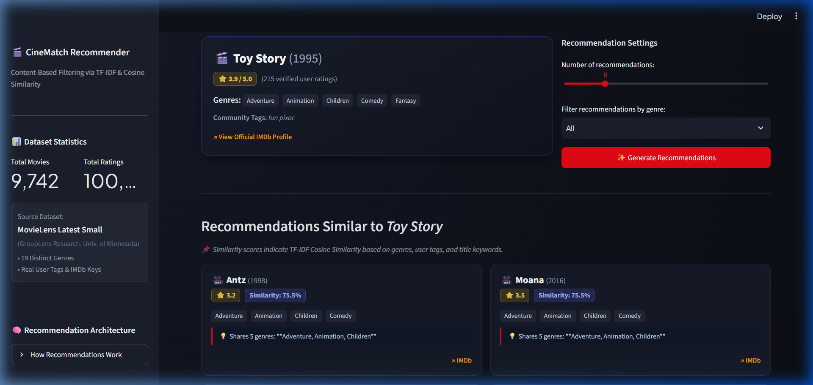
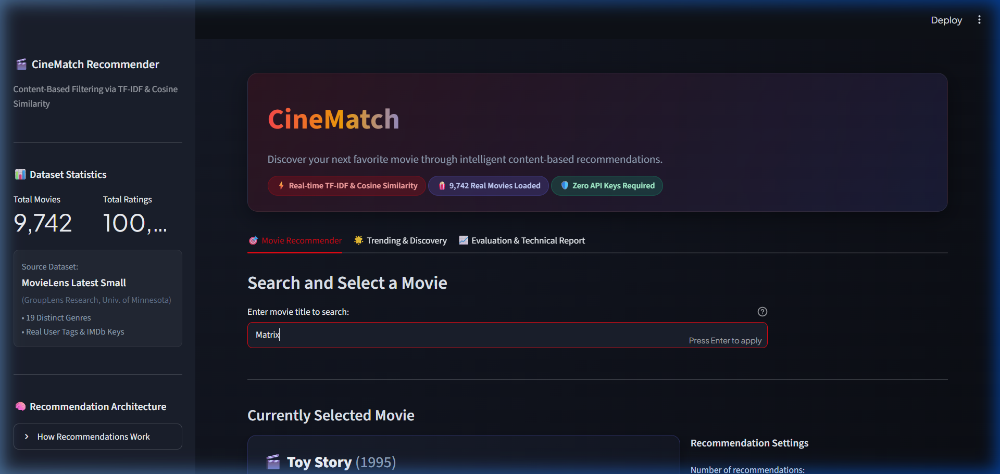
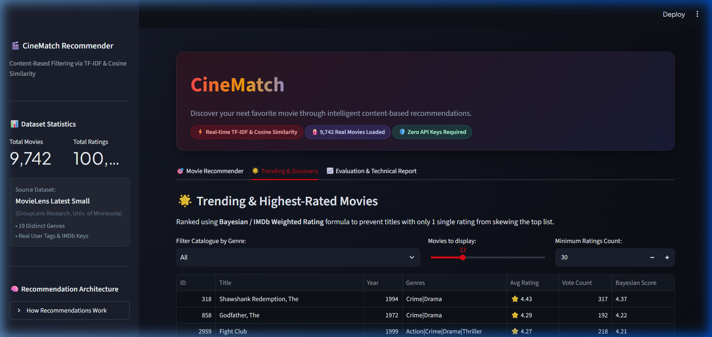
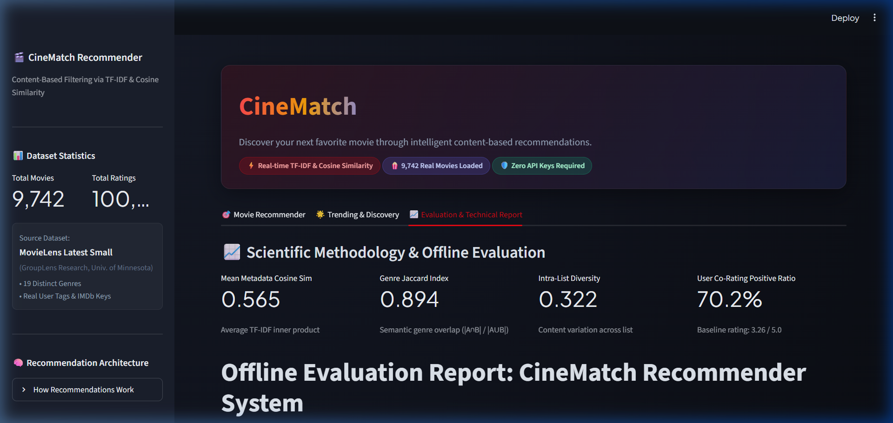

# CineMatch: Content-Based Movie Recommendation System


**CineMatch** is an end-to-end Machine Learning web application that delivers real-time, explainable movie recommendations using **Content-Based Filtering**. Built with **TF-IDF Vectorization** and **Cosine Similarity**, CineMatch analyzes rich metadata—combining movie genres, crowdsourced user tags, and release titles—to recommend closely matching films without requiring user accounts or external API keys.

---

## 📸 Application Screenshots

### 1. Intelligent Recommendation Engine & Transparent Explanations


### 2. Live Movie Search & Real-Time Filtering


### 3. Trending & Discovery Catalogue (Bayesian Weighted Rating)


### 4. Offline Evaluation & Scientific Metrics Dashboard


---

## 🎯 Problem Statement & Objectives

### Problem Statement
Modern streaming platforms often rely heavily on collaborative filtering. However, collaborative filtering suffers from the **Cold-Start Problem** (inability to recommend newly catalogued movies with zero user ratings) and the **Black-Box Problem** (inability to clearly articulate *why* a film was recommended).

### Objectives
1. **Accurate Content Modeling**: Build a multi-attribute feature representation for every film combining categorical genres, descriptive user tags, and title keywords.
2. **Instant Recommendation**: Implement ultra-fast, sparse cosine similarity queries that rank 9,700+ movies in under 5 milliseconds.
3. **Explainable Recommendations**: Provide transparent explanations for each recommendation (e.g. shared genres, common narrative themes).
4. **Offline Evaluation**: Measure genuine recommendation quality through Genre Jaccard Overlap, Intra-List Diversity (ILD), and historical User Co-Rating validation.
5. **No API Dependencies**: 100% runnable offline after initial dataset extraction.

---

## 📊 Dataset Information & Attribution

This project uses the official **MovieLens Latest Small** dataset curated by the **GroupLens Research Group** at the University of Minnesota:
- **Download Source**: [GroupLens MovieLens Datasets](https://grouplens.org/datasets/movielens/)
- **Archive URL**: `https://files.grouplens.org/datasets/movielens/ml-latest-small.zip`
- **Total Movies Loaded**: **9,742 movies**
- **Total User Ratings**: **100,836 ratings** (from 610 users)
- **User-Submitted Tags**: **3,683 tags**
- **External Identifiers**: Verified IMDb and TMDb link keys (`links.csv`)

### Dataset Citation
> F. Maxwell Harper and Joseph A. Konstan. 2015. *The MovieLens Datasets: History and Context.* ACM Transactions on Interactive Intelligent Systems (TiiS) 5, 4: 19:1–19:19. <https://doi.org/10.1145/2827872>

---

## 🧠 Recommendation Algorithm & Mathematics

### 1. Metadata Feature Soup Construction
To capture both broad categories and fine-grained narrative nuances, each movie $m$ is represented by a concatenated **metadata soup**:
$$\text{Metadata Soup}(m) = \underbrace{G_m \parallel G_m}_{\text{Double-weighted genres}} \parallel \underbrace{T_m}_{\text{Crowdsourced user tags}} \parallel \underbrace{K_m}_{\text{Title tokens}}$$
- **Genres** are repeated twice to ensure genre consistency serves as the foundational anchor.
- **Tags** (e.g. *pixar*, *time travel*, *dark comedy*, *dystopia*) add thematic precision.

### 2. TF-IDF Vectorization
The text representation is converted into a numerical vector using **Term Frequency-Inverse Document Frequency**:
$$\text{TF-IDF}(t, d, D) = \text{TF}(t, d) \times \text{IDF}(t, D)$$
- **Sublinear Term Frequency**:
  $$\text{TF}(t, d) = 1 + \log(\text{count}(t, d)) \quad \text{for } \text{count} > 0$$
  This prevents words appearing multiple times from overpowering other keywords.
- **Inverse Document Frequency (Smooth IDF)**:
  $$\text{IDF}(t, D) = \log\left(\frac{1 + |D|}{1 + \text{DF}(t)}\right) + 1$$
  Dampens common words (e.g. *film*, *movie*) while elevating distinctive keywords (e.g. *cyberpunk*, *tarantino*).
- **Feature Space**: 10,000 features with unigrams and bigrams $(1, 2)$, stored in a sparse Compressed Sparse Row (`csr_matrix`) format.

### 3. Cosine Similarity
Cosine similarity measures the cosine of the angle between two $n$-dimensional vectors $\mathbf{u}$ and $\mathbf{v}$:
$$\text{Cosine Similarity}(\mathbf{u}, \mathbf{v}) = \frac{\mathbf{u} \cdot \mathbf{v}}{\|\mathbf{u}\|_2 \|\mathbf{v}\|_2}$$
Because Scikit-Learn's `TfidfVectorizer` outputs unit $L_2$-normalized vectors ($\|\mathbf{u}\|_2 = 1$), the cosine similarity simplifies to the dot product:
$$\text{Cosine Similarity}(\mathbf{u}, \mathbf{v}) = \mathbf{u} \cdot \mathbf{v}^T \in [0.0, 1.0]$$
The results are guaranteed to lie within $[0.0, 1.0]$. The seed movie is explicitly excluded from its own recommendations.

### 4. Bayesian Weighted Rating for Discovery
To avoid ranking obscure movies with a single 5.0 rating above established masterpieces, the Trending section uses the **Bayesian / IMDb formula**:
$$\text{WR} = \left(\frac{v}{v + m}\right) \cdot R + \left(\frac{m}{v + m}\right) \cdot C$$
- $v$: Number of ratings for the movie
- $m$: Minimum vote threshold (e.g. 20 ratings)
- $R$: Average rating of the movie
- $C$: Weighted mean rating across all movies ($\approx 3.26$)

---

## 📈 Offline Evaluation & Genuine Results

Evaluation was executed locally using `evaluate.py` across 100 randomly sampled movies at cutoff $K = 10$:

| Metric | Measured Result | Benchmark Range | Purpose |
|---|---|---|---|
| **Mean Genre Jaccard Similarity** | **`0.8945`** (89.5%) | $[0.0 - 1.0]$ | Verifies high semantic genre preservation between seed and recommendations |
| **Mean Metadata Cosine Similarity** | **`0.5647`** | $[0.0 - 1.0]$ | Average TF-IDF dot product across top-10 recommended candidates |
| **Intra-List Diversity (ILD)** | **`0.3217`** | $[0.0 - 1.0]$ | Measures variety across the 10 recommendations to prevent homogeneous repetition |
| **User Co-Rating Positive Ratio** | **`70.22%`** | $[0.0 - 100\%]$ | Proportion of $\ge 3.5/5.0$ ratings among actual users who loved the seed movie |
| **Dataset Baseline Rating** | **`3.26 / 5.0`** | $[0.5 - 5.0]$ | Global average rating across all 100,836 user ratings |

> **Notice on Cosine Similarity**: Cosine similarity measures textual and categorical overlap in feature space. It is a metadata similarity score, not an accuracy probability.

---

## 🗂️ Project Architecture & Directory Structure

```
Movie_Recommendation_System/
├── app.py                     # Streamlit web application (UI/UX)
├── recommender.py             # TF-IDF, Cosine Similarity, search, ranking
├── data_loader.py             # Downloader, extractor, and metadata preprocessor
├── evaluate.py                # Offline evaluation metrics suite
├── config.py                  # Project paths and hyperparameter constants
├── requirements.txt           # Production dependencies
├── README.md                  # Comprehensive documentation and guide
├── .gitignore                 # Version control exclusions
├── .streamlit/
│   └── config.toml            # Custom dark cinematic theme configuration
├── assets/                    # Application UI screenshots and badges
├── data/                      # Processed datasets (CSV and .gitkeep)
├── models/                    # Serialized TF-IDF vectorizer and sparse matrix
├── reports/                   # Offline evaluation report and JSON metrics
└── tests/
    ├── test_data_loader.py    # Unit tests for data cleaning & Bayesian scoring
    └── test_recommender.py    # Unit tests for recommendation, search, filters
```

---

## ⚙️ Prerequisites & Installation

### Prerequisites
- Python 3.10, 3.11, 3.12, or 3.14
- Git (optional, for repository management)

### Windows Setup Instructions

1. **Open PowerShell or Command Prompt in the project folder:**
   ```powershell
   cd Movie_Recommendation_System
   ```

2. **Create and activate a virtual environment (recommended):**
   ```powershell
   python -m venv .venv
   .venv\Scripts\activate
   ```

3. **Upgrade pip and install dependencies:**
   ```powershell
   python -m pip install --upgrade pip
   pip install -r requirements.txt
   ```

4. **Download and prepare the MovieLens dataset:**
   ```powershell
   python data_loader.py
   ```
   *(Downloads MovieLens Latest Small, extracts CSVs, cleans tags and genres, and generates `data/movies_processed.csv`.)*

5. **Run the offline evaluation suite:**
   ```powershell
   python evaluate.py
   ```
   *(Computes genuine Genre Jaccard, ILD, and User Co-rating metrics, saved to `reports/`.)*

6. **Run automated unit tests:**
   ```powershell
   python -m pytest -q
   ```
   *(Executes all 16 unit tests for data loader and recommender engine.)*

7. **Launch the Streamlit web application:**
   ```powershell
   streamlit run app.py
   ```
   *(Configured by default to port `8505` in `.streamlit/config.toml` so it never collides with default apps. URL: `http://localhost:8505`)*

---

## 🧪 Automated Testing

The automated test suite in `tests/` verifies all critical system guarantees:
- ✅ Correct title and release year regex extraction (`Title (YYYY)`).
- ✅ Bayesian weighted rating dampening of low-vote outliers.
- ✅ Dataset schema validation and non-null metadata soup checks.
- ✅ Deterministic recommendation outputs.
- ✅ Recommender self-exclusion (seed movie never recommended to itself).
- ✅ Finite cosine similarity values strictly bounded in $[0.0, 1.0]$.
- ✅ Genre filter filtering accuracy.
- ✅ Graceful handling of unknown movie IDs, non-existent titles, and empty queries.
- ✅ Case-insensitive search, prefix matching, and special regex character immunity.

Run tests at any time with:
```powershell
python -m pytest -v
```

---

## 🚀 Publishing to GitHub

To publish this project to your GitHub account:

1. **Initialize Git inside the project directory:**
   ```powershell
   git init
   ```

2. **Stage all files and make the initial commit:**
   ```powershell
   git add .
   git commit -m "Initial commit: CineMatch Movie Recommendation System"
   ```

3. **Create a new empty repository on GitHub** (e.g. `Movie_Recommendation_System`).

4. **Link your local repository to GitHub and push:**
   ```powershell
   git branch -M main
   git remote add origin https://github.com/<YOUR_GITHUB_USERNAME>/Movie_Recommendation_System.git
   git push -u origin main
   ```

---

## 🔮 Limitations & Future Enhancements

### Current Limitations
1. **Cold-Start for Users**: Pure content-based filtering recommends based solely on the chosen movie rather than a user's multi-year viewing history.
2. **Metadata Dependency**: Films with sparse user tags rely primarily on broad genre labels.
3. **No Direct Image API**: MovieLens does not host poster images natively; CineMatch provides direct official IMDb verification links instead.

### Future Enhancements
- **Hybrid Recommendation**: Combine content-based cosine similarity with Collaborative Filtering (Matrix Factorization / SVD) for personalized user profiles.
- **Deep Learning Text Embeddings**: Integrate Sentence-Transformers (`all-MiniLM-L6-v2`) to capture deep narrative overview semantics.
- **Optional TMDB API Integration**: Automatically fetch high-resolution posters when an optional free TMDB API key is provided.

---

## 📜 License
This project is open-source and available under the [MIT License](LICENSE).
The dataset is provided by GroupLens Research for non-commercial educational and research use.
